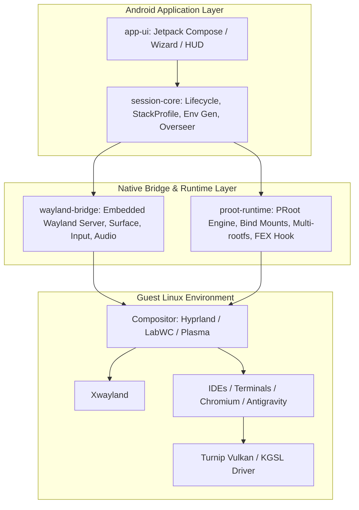

# Android Linux Workstation (ALW)

A high-performance, modular Android platform designed to turn unrooted Android tablets—specifically targeting the **Xiaomi Pad 8** (Qualcomm Snapdragon 8s Gen 4, Adreno 825 GPU, Xiaomi HyperOS)—into a portable development workstation running **Arch Linux ARM (`aarch64`)** with a native embedded Wayland desktop environment.

---

## Key Highlights

- **Zero-Terminal One-Tap Onboarding:** Streamlined first-launch wizard inspired by *DroidDesk*. Single-tap provisioning configures Arch Linux ARM rootfs, `pacman`, `xorg-xwayland`, `pipewire`, Mesa Turnip drivers, `yay`/`paru` (pre-configured with `--mflags "-A"` for native `aarch64` builds of `x86_64`-tagged PKGBUILDs), and sets global Electron/Chromium Wayland and sandbox flags.
- **Profile-Driven Stack Configurator (`StackProfile`):** Strictly non-destructive runtime injection. All user customizations serialize to a JSON model and are passed via CLI flags, environment variables, and `--bind` mounts. Guest dotfiles (such as `~/.config/hypr/hyprland.conf`) are preserved untouched.
- **Direct Adreno Turnip / Freedreno KGSL Acceleration:** Direct user-space Vulkan acceleration targeting Qualcomm Adreno 825 via `/dev/kgsl-3d0` node mapping and an external Mesa Turnip driver manager. Clean fallback to Zink or `llvmpipe`.
- **Native Wayland Surface Bridge:** Embedded Android Surface wrapping a custom C/Rust Wayland server runtime (referencing `Beauty114514/trierarch-app`), supporting relative hardware pointer capture (`View.requestPointerCapture()`), physical keyboard remapping (`caps:super` to bypass HyperOS Super key capture), and low-latency audio via PipeWire/PulseAudio UNIX domain sockets.
- **Selective Storage & Cache Redirection:** Selective `/mnt/sdcard` binding (excluding `/storage/emulated/0/Android/data` to prevent permission bottlenecks) and automatic redirection of heavy build caches (`CARGO_TARGET_DIR`, `UV_PROJECT_ENVIRONMENT`, `PNPM_STORE_DIR`) to internal UFS storage.
- **Transparent x86_64 Emulation Layer:** Optional PRoot `-q` emulator hook (`FEXInterpreter` with Vulkan/GL thunking or `box64`) triggered solely for foreign `x86_64` ELFs, keeping native `aarch64` binaries executing with zero overhead.
- **Process Lifecycle & Shizuku Companion:** Foreground service with `PARTIAL_WAKE_LOCK`, combined with an optional **Shizuku (`UID 2000`)** companion to manage Android phantom process limits (`max_phantom_processes`), whitelist Xiaomi PowerKeeper battery restrictions, and stream Adreno KGSL GPU telemetry.

---

## Architecture Overview

ALW enforces a decoupled, modular design divided across four core modules:

1. **`app-ui`**: Android Jetpack Compose frontend providing the First-Launch Wizard, Stack Configurator, Compositor Switcher, Runtime Dashboard, and Shizuku GPU Telemetry HUD.
2. **`session-core`**: Core orchestration engine managing `StackProfile` validation, session launch sequences, dynamic `/tmp/android-session.conf` generation, foreground service lifecycle, and IPC channels.
3. **`proot-runtime`**: Unrooted Linux environment manager wrapping PRoot v5.4.0+, multi-rootfs directory isolation (`files/rootfs/<id>`), selective bind mounts, `--symlink2file` ptrace extensions, and x86_64 translation hooks.
4. **`wayland-bridge`**: Native C/Rust Wayland protocol server embedded directly into the Android `SurfaceView`/`TextureView`, handling hardware input normalization, pointer capture, and low-latency audio socket forwarding.

---

## Documentation Tree

This repository adheres to [Dev Framework v0.2](docs/dev-framework/DEV-FRAMEWORK-v0.2.md).

- **Task Board:** [TASKS.md](TASKS.md) (Central, authoritative workflow status)
- **Software Requirements Specification (SRS):** [docs/srs/ANDROID-LINUX-WORKSTATION-SRS-v0.1.md](docs/srs/ANDROID-LINUX-WORKSTATION-SRS-v0.1.md)
- **System Architecture & Design:**
  - [System Architecture](docs/architecture/ARCHITECTURE.md)
  - [StackProfile Schema Specification](docs/architecture/STACK-PROFILE-SCHEMA.md)
  - [Wayland Native Bridge Design](docs/architecture/WAYLAND-BRIDGE-DESIGN.md)
  - [PRoot Runtime Engine Design](docs/architecture/PROOT-RUNTIME-DESIGN.md)
  - [Turnip & KGSL Integration Guide](docs/architecture/TURNIP-KGSL-INTEGRATION.md)
  - [Shizuku Companion & Lifecycle Service](docs/architecture/SHIZUKU-LIFECYCLE-SERVICE.md)
- **Initiatives & Backlog:**
  - [Workstation Initiative Index](docs/initiatives/android-linux-workstation/INITIATIVE.md)
  - [Backlog & Sequencing](docs/initiatives/android-linux-workstation/BACKLOG.md)
  - [Requirements Traceability Matrix](docs/initiatives/android-linux-workstation/REQUIREMENTS.md)
  - [Phase 0 Epic](docs/initiatives/android-linux-workstation/epics/phase-0-architecture-planning/EPIC.md)
  - [Phase 1 Epic](docs/initiatives/android-linux-workstation/epics/phase-1-core-runtime-proot/EPIC.md)
  - [Phase 2 Epic](docs/initiatives/android-linux-workstation/epics/phase-2-wayland-turnip-compositor/EPIC.md)
  - [Phase 3 Epic](docs/initiatives/android-linux-workstation/epics/phase-3-onboarding-ui-integrations/EPIC.md)
  - [Phase 4 Epic](docs/initiatives/android-linux-workstation/epics/phase-4-benchmarking-hardening/EPIC.md)
- **Task Records & Decision Records (ADRs):**
  - [TASK-001: Architecture, Roadmap, and Decision Baseline](docs/tasks/TASK-001/TASK.md)
  - [TASK-001 Decisions (ADR-001 to ADR-008)](docs/tasks/TASK-001/DECISION.md)
