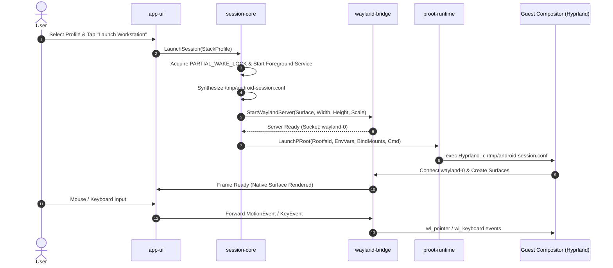

# System Architecture & Module Breakdown

**Status:** Approved Architectural Baseline (Phase 0)  
**Document:** `docs/architecture/ARCHITECTURE.md`  
**Reference Implementations:** `Beauty114514/trierarch-app` (Wayland surface & PRoot bridge), `DroidDesk` (Zero-terminal onboarding)  

---

## 1. Architectural Philosophy

The Android Linux Workstation (ALW) is engineered around decoupled, base-agnostic interfaces. No layer directly couples UI presentation to low-level ptrace execution or Wayland protocol serialization. The system separates high-level user intent from low-level runtime execution via an immutable configuration model (`StackProfile`).

```
+-------------------------------------------------------------------------+
|                                 app-ui                                  |
|   (Jetpack Compose, Onboarding Wizard, Stack Configurator, HUD Overlay) |
+------------------------------------+------------------------------------+
                                     | Kotlin Flow / State
                                     v
+-------------------------------------------------------------------------+
|                              session-core                               |
|   (Session Orchestrator, StackProfile Engine, Foreground Svc, IPC Mgr)   |
+-------------------+---------------------------------+-------------------+
                    |                                 |
                    v (JNI / Process Launch)          v (JNI / SurfaceView)
+------------------------------------+   +--------------------------------+
|           proot-runtime            |   |         wayland-bridge         |
| (PRoot Engine, Bind Mounts, Multi- |   | (C/Rust Embedded Wayland Svr,  |
| rootfs, ptrace, FEX-x86 Hook)      |   | ANativeWindow, Input, Audio)   |
+-------------------+----------------+   +----------------+---------------+
                    |                                     |
                    +------------------+------------------+
                                       |
                                       v
+-------------------------------------------------------------------------+
|                        Guest Linux Environment                          |
|  (Arch Linux ARM, Hyprland / LabWC, Turnip KGSL Vulkan, Apps & IDEs)    |
+-------------------------------------------------------------------------+
```

---

## 2. Module Specifications

### 2.1 `app-ui` (Android Presentation Layer)
- **Technology:** Kotlin 2.1.0, Jetpack Compose (BOM 2024.11.00), Material 3.
- **Responsibilities:**
  - **First-Launch Wizard:** Three-tap onboarding flow (Distro, Compositor, GPU preset) with automated download/install actions.
  - **Stack Configurator:** Interactive configuration editor for `StackProfile` (resolutions, compositor flags, driver overrides, storage mounts).
  - **Desktop Viewport:** Fullscreen `SurfaceView` container hosting the embedded Wayland surface with pointer capture handling.
  - **HUD & Telemetry Overlay:** Real-time translucent overlay displaying CPU/GPU frequencies, temperature, KGSL memory usage, and battery drain rate.
  - **Safe Mode Launcher:** Quick recovery button to launch `LabWC + llvmpipe` when custom configurations fail.

### 2.2 `session-core` (Orchestration & State Management)
- **Technology:** Kotlin Coroutines & Flow, Android Jetpack Lifecycle & Service framework.
- **Responsibilities:**
  - **Profile Engine:** Validates, serializes, and deserializes `StackProfile` JSON models.
  - **Session Controller:** Coordinates the startup and teardown sequence across `wayland-bridge` and `proot-runtime`.
  - **Config Synthesizer:** Generates non-destructive session overrides (e.g. `/tmp/android-session.conf` sourcing user dotfiles before appending runtime overrides).
  - **Foreground Service Host:** Maintains a high-priority Android Foreground Service holding a `PARTIAL_WAKE_LOCK` to ensure continuous execution during compilation.
  - **Compositor IPC Client:** Communicates with active compositors over UNIX domain sockets (e.g. `hyprctl keyword` for dynamic resolution and scaling changes).

### 2.3 `proot-runtime` (Isolated Linux Environment)
- **Technology:** C/C++ (NDK r27c), PRoot v5.4.0+, Linux ptrace API.
- **Responsibilities:**
  - **Multi-Rootfs Storage:** Manages isolated rootfs directories under `files/rootfs/<id>/`.
  - **Automated Provisioning:** Executes silent Arch Linux ARM setup: initializes pacman keys, installs `xorg-xwayland`, `pipewire`, `yay`/`paru` (`--mflags "-A"`), and sets Electron/Chromium flags.
  - **Bind Mount Bridge:** Mounts internal UFS paths, selective `/mnt/sdcard` bridges (excluding `/Android/data`), and device nodes (`/dev/kgsl-3d0`, `/dev/null`, `/dev/urandom`).
  - **Build Cache Redirection:** Enforces environment variables (`CARGO_TARGET_DIR`, `UV_PROJECT_ENVIRONMENT`, `PNPM_STORE_DIR`) to point to fast internal UFS storage.
  - **Syscall Emulation & Extensions:** Implements fake root (`UID 0`) translation, `--symlink2file` emulation on non-POSIX storage, and transparent `-q` hooks for foreign `x86_64` binaries via `FEXInterpreter` / `box64`.

### 2.4 `wayland-bridge` (Native Display, Input & Audio Server)
- **Technology:** C17 / Rust (via `cargo-ndk`), `libwayland-server`, Android `ANativeWindow`, Linux epoll/eventfd.
- **Responsibilities:**
  - **Embedded Wayland Compositor Server:** Runs a native Wayland server thread listening on `$XDG_RUNTIME_DIR/wayland-0`.
  - **Surface Rendering:** Directly composites Wayland client buffers (`wl_shm`, `linux_dmabuf_v1`) into the Android `ANativeWindow` buffer queue with double/triple buffering.
  - **Hardware Pointer Capture:** Hooks Android `MotionEvent` and `View.requestPointerCapture()` to feed relative mouse deltas (`wl_pointer.motion`) without Android cursor boundary clamping.
  - **Hardware Keyboard Mapping:** Translates physical Android `KeyEvent` scancodes into Linux evdev scancodes, automatically injecting `caps:super` to bypass Xiaomi HyperOS system Super key interception.
  - **PipeWire / PulseAudio Socket Bridge:** Routes audio streams from guest PipeWire to Android low-latency audio sinks (Oboe / `AAudio`).

---

## 3. Inter-Module Data Flow & Lifecycle



---

## 4. Architectural Boundaries & Non-Goals

1. **Non-Destructive Guarantee:**
   The guest user's `/home/<user>/` directory is treated as user-owned property. Neither `session-core` nor `proot-runtime` may rewrite dotfiles. All dynamic customizations are appended via temporary includes or IPC.
2. **Base-Agnostic Seams:**
   Should PRoot be replaced by a native container (unshare/chroot) or virtual machine (microdroid / KVM on supported kernels) in future revisions, `app-ui`, `session-core`, and `wayland-bridge` remain unchanged.
3. **No Root Requirement:**
   The entire system must operate within the standard Android application sandbox without requiring root privileges or bootloader unlocking.
