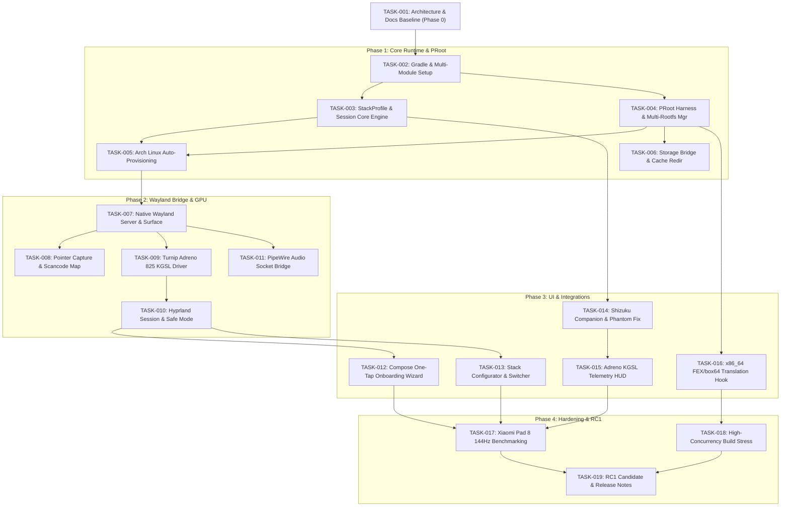

# Workstation Backlog & Task Sequencing

**Initiative:** [Android Linux Workstation](INITIATIVE.md)  
**Central Task Board:** [TASKS.md](../../../TASKS.md)  

---

## 1. Task Dependency Graph

---

## 2. Sequenced Task Inventory

| ID | Title | Epic | Risk | Prerequisites |
|---|---|---|---|---|
| **TASK-001** | Architecture Baseline, Docs Hierarchy & ADRs | Phase 0 | Standard | None |
| **TASK-002** | Scaffolding, Multi-Module Gradle & Toolchain | Phase 1 | Standard | TASK-001 |
| **TASK-003** | `session-core` State Machine & `StackProfile` Engine | Phase 1 | Standard | TASK-002 |
| **TASK-004** | `proot-runtime` PRoot Harness & Multi-Rootfs Manager | Phase 1 | High Risk | TASK-002 |
| **TASK-005** | Arch Linux ARM Automated Provisioning Script | Phase 1 | Standard | TASK-003, TASK-004 |
| **TASK-006** | Selective Storage Bridge & Build Cache Redirection | Phase 1 | High Risk | TASK-004 |
| **TASK-007** | `wayland-bridge` Native C/Rust Surface Server | Phase 2 | Critical | TASK-005 |
| **TASK-008** | Pointer Capture & Hardware Scancode Mapping (`caps:super`) | Phase 2 | High Risk | TASK-007 |
| **TASK-009** | Turnip Adreno 825 KGSL Driver Manager & Node Binding | Phase 2 | Critical | TASK-007 |
| **TASK-010** | Compositor Orchestration: Hyprland & Safe Mode | Phase 2 | High Risk | TASK-009 |
| **TASK-011** | Low-Latency PipeWire / PulseAudio Socket Bridge | Phase 2 | Standard | TASK-007 |
| **TASK-012** | `app-ui` First-Launch Wizard & Automated Installer | Phase 3 | Standard | TASK-010 |
| **TASK-013** | Stack Configurator UI & Live Compositor Switcher | Phase 3 | Standard | TASK-010 |
| **TASK-014** | Shizuku Companion (`UID 2000`) & Phantom Process Manager | Phase 3 | High Risk | TASK-003 |
| **TASK-015** | Real-Time Adreno KGSL GPU Telemetry HUD Overlay | Phase 3 | Standard | TASK-014 |
| **TASK-016** | Optional x86_64 FEX/box64 Translation Hook (`-q`) | Phase 3 | High Risk | TASK-004 |
| **TASK-017** | Xiaomi Pad 8 Hardware Hardening & 144Hz Benchmarks | Phase 4 | High Risk | TASK-012, TASK-013, TASK-015 |
| **TASK-018** | High-Concurrency Build Stress & Thermal Throttling Test | Phase 4 | High Risk | TASK-016 |
| **TASK-019** | RC1 Candidate Packaging, Security Audit & Release | Phase 4 | Critical | TASK-017, TASK-018 |
